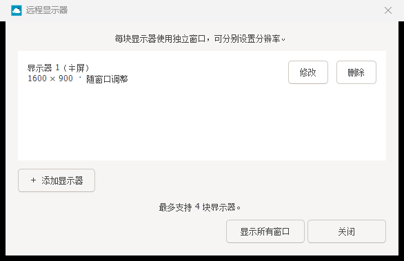
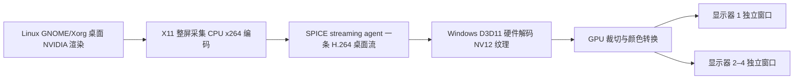

# flexVDI SPICE DX

基于 **flexVDI Client 3.1.7 / SPICE GTK 0.42** 的 Windows 客户端改造，配合 Linux 客户机中的整屏 H.264 服务，实现 GPU 解码上屏、连接历史和独立窗口多显示器。

本仓库包含客户端完整源码、可直接应用到上游发行版的依赖补丁，以及 **spice-streaming-agent 服务端修改 patch、NVIDIA 多屏控制服务和 PVE 配置说明**。这是社区修改版，与上游官方发行版本有区别。

## 已实现

| 功能 | 行为 |
| --- | --- |
| 整屏 H.264 | 整个扩展桌面通过一条 H.264 流传输，客户端只解码一次 |
| GPU Direct | GStreamer `d3d11h264dec` 输出 NV12 解码纹理，D3D11 VideoProcessor 裁切、转换并写入各窗口交换链 |
| 低延迟呈现 | `Present(0, DO_NOT_WAIT)`；每个交换链独立限制一帧待呈现，无视频刷新定时器、无逐帧 CPU 回读与上传 |
| 显示器管理 | 默认单屏，逐块添加、修改、删除，最多四块，每块对应独立窗口 |
| 自定义分辨率 | 每屏可设 320×200～3840×2160，向上对齐到偶数像素；不同屏可使用不同尺寸 |
| 窗口自适应 | 每屏默认随窗口大小调整远程分辨率，停止拉伸约 400ms 后提交；也可设为固定分辨率 |
| 连接历史 | 主页显示最近成功连接及桌面缩略图，最多 50 条，不保存连接 URI 中的密码或令牌 |
| 文件与 USB | 保留 SPICE WebDAV 目录共享、USB 重定向和共享 CD 支持；需要相应客户机服务与 USB 通道 |
| NVIDIA 桌面 | Ubuntu GNOME/Xorg 可由直通 NVIDIA 显卡渲染，虚拟输出通过独立 EDID 和 XRandR 创建 |



## 图像链路



当前服务器使用 **CPU 采集与 x264 编码**，目标 60fps / 20Mbps；没有实现 NVENC 编码。Windows GPU 仍进行一次 NV12→BGRA 色彩转换；它不是 NV12 Overlay / Decode Swap Chain 零转换上屏。连接历史缩略图在需要时单独回读，不在逐帧呈现路径中。

## 使用

需要先按 [服务端部署说明](docs/SERVER.md) 配置两个 SPICE 端口及 Linux 服务，再按 [Windows 构建说明](docs/BUILD-WINDOWS.md) 构建、打包客户端。本仓库提供源码，不包含 MSYS2 环境、编译缓存或预编译运行包。

在打包目录运行 PowerShell（将地址改成自己的 SPICE 监听地址）：

```powershell
.\Launch.ps1 -Dx -Windowed -SpiceUri 'spice://HOST:PORT' -SharedFolder 'D:\share'
.\Launch.ps1 -HomePage -Dx
```

`Launch.ps1` 放在包含 `bin/`、`lib/`、`share/` 的运行包根目录。共享目录参数可省略。直接连接需要明确指定地址；主页可从历史记录或输入地址发起连接。

连接后，点击工具栏的**显示器**按钮：

1. **添加显示器**：输入宽度和高度，选择是否随窗口调整。
2. **修改**：分别修改某块屏幕的尺寸与自动调整开关。
3. **删除**：移除远程屏幕，至少保留一块；删除主屏时剩余屏幕自动接替。

新增/修改时先应用指定尺寸，之后再次拉伸窗口才自动调整。关闭副屏窗口仅隐藏该窗口，“显示所有窗口”可恢复；关闭主屏断开连接。两屏左右排列，三到四屏按两列排列。布局保存在客户机 `/var/lib/spice-displays/layout.json`，之后连接会恢复已保存布局。

## 源码与补丁

| 路径 | 内容 |
| --- | --- |
| `src/`、`resources/` | 修改后的完整 flexVDI 客户端源码与资源 |
| [patches/client](patches/client) | 相对上游 3.1.7 的客户端完整功能补丁 |
| [patches/spice-gtk](patches/spice-gtk) | 相对 SPICE GTK 0.42 的完整 Windows、D3D11、H.264、多屏呈现补丁 |
| [patches/dependencies](patches/dependencies) | libsoup 2、phodav 2、flexdp 的 Windows 构建修正 |
| [server/patches](server/patches) | **相对 spice-streaming-agent 0.3 的整屏采集与 H.264 服务端补丁** |
| [server/nvidia](server/nvidia) | NVIDIA 虚拟显示器、协议 v2 控制服务、EDID 生成器、systemd/udev 配置 |
| [server/streaming](server/streaming) | H.264 容器构建与运行配置 |
| [sources.lock.json](sources.lock.json) | 上游来源、精确版本、提交号和发行包 SHA256 |

补丁应用顺序和验证方式见 [PATCHES.md](docs/PATCHES.md)。**PVE 的 QEMU 和 libspice-server 没有被替换或修改**；宿主侧仅增加 SPICE 端口配置。此前试验过但未部署的 spice-server 修改不包含在本项目中。

## 环境与验证范围

- 已运行环境：Windows x64 / MSYS2 UCRT64；Ubuntu GNOME X11；PVE KVM。
- 已验证显卡组合：客户机 RTX 5090 D，Windows RTX 5060 Laptop。
- GStreamer D3D11 提供 Windows GPU API 抽象，但 AMD / Intel 的完整链路尚未实机验证。
- 已验证单屏、混合分辨率双屏、四屏、增删改、自动调整、固定分辨率及主屏切换，详见 [VALIDATION.md](docs/VALIDATION.md)。
- 多屏总像素增加会增加服务端 CPU 采集/编码开销；60fps 是目标，不能作为所有分辨率下的保证。
- 当前 NVIDIA 多屏控制实现针对 GNOME/Xorg、`DISPLAY=:0`；Wayland 和其他桌面环境不在已验证范围。
- DX 模式连接 streaming-agent 的显示通道 1。迁移到 NVIDIA 后，普通 VirtIO 通道 0 不承载该 GNOME 桌面。
- DX 硬解不可用时显式报错，不自动切换软件解码。旧媒体时钟绘制路径可显式选择。

## 许可证

保留上游作者与版权声明。flexVDI 客户端遵循 [GPL-3.0](LICENSE)；SPICE GTK、spice-streaming-agent、libsoup 和 phodav 的许可证副本位于 [licenses](licenses)。各组件与其补丁遵循对应组件许可证；新显示控制与辅助脚本按 GPL-3.0-or-later 提供。第三方运行时的再分发还需保留对应许可证与满足其源码提供义务。

